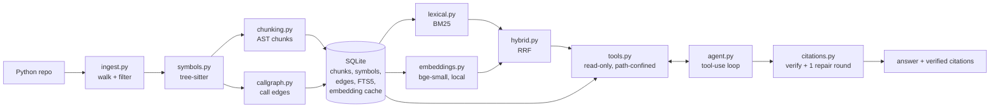

# coderag

Ask questions about a Python repository and get answers with **line-level citations that are checked against the code**. coderag chunks code by syntax (functions, classes, methods), retrieves with BM25 plus optional embeddings, runs a read-only tool-using agent, and verifies every citation before showing it.

Every metric below is produced by a reproducible harness whose ground truth comes from the code itself, so there are no hand labels.

## How it works



- **Chunking:** one chunk per top-level function, class (header, docstring and fields, with methods carved out), and method, plus module-level code. Over-budget units are split only at statement boundaries, and every chunk starts with a `# path :: qualified.name` header.
- **Retrieval:** SQLite FTS5 BM25 over identifier-aware tokens (`parseConfig`, `parse_config` and `ParseConfig` all match `parse config`). Optionally fused with local `BAAI/bge-small-en-v1.5` vectors by reciprocal rank fusion (k=60).
- **Call graph:** call sites from tree-sitter, resolved by static scope rules (imports, aliases, relative imports, `self.` methods). Anything not resolvable that way is flagged `ambiguous` or `unresolved`, never guessed.
- **Agent:** four read-only tools (`search_code`, `search_symbols`, `read_file`, `find_callers`). Tool output is wrapped in delimiters as untrusted data, `read_file` rejects absolute paths, `..`, and symlinks that escape the repo, and the final answer must match a JSON schema.
- **Citations:** each cited `path:start-end symbol` is checked (the file exists, the lines are valid and not too many, and the symbol is defined there). Failures get one repair round, and an answer with no verified citation is flagged `unsupported`.

## Quickstart

Requires Python `3.11+` and `git`.

```bash
python3 -m venv .venv && .venv/bin/pip install -e '.[embed,app]' pytest ruff httpx
.venv/bin/python scripts/fetch_model.py          # one-time embedding model download (needs .[embed])
.venv/bin/coderag index path/to/repo
export ANTHROPIC_API_KEY=...  CODERAG_MODEL=claude-opus-5-5
.venv/bin/coderag ask path/to/repo "Where is the config file parsed?"
```

```bash
make gate     # ruff + unit tests + eval tests + frozen-file check
make eval     # writes reports/eval.{json,md} and reports/ablation_chunking.{json,md}
make claims   # non-gating improvement claims -> reports/claims.json
CODERAG_ALLOWED_ROOTS=/path/to/repos .venv/bin/uvicorn --factory coderag.api:create_app
```

`coderag ask` prints each citation as `verified` or `UNVERIFIED (reason)`. The API serves `GET /health`, `POST /index` and `POST /ask`, and only repositories under `CODERAG_ALLOWED_ROOTS` are accepted.

## Evaluation method

- **Two independent parsers.** The system parses with tree-sitter, and the ground truth comes from Python's stdlib `ast`. Tree-sitter symbol spans match the `ast` oracle exactly on the fixture and on the eval repo, so the eval is not grading a parser against itself.
- **Auto-generated questions** from the `ast` oracle, deterministic per seed:
  - `definition`: "Where is `name` defined?"
  - `docstring_masked`: a function's first docstring sentence with the words of its own name removed, which tests semantic retrieval rather than name matching.
  - `callers`: "Which functions call `name`?"
- **Hit rule:** a retrieved chunk counts when it covers at least half of the truth span's lines.
- **Eval repo:** pallets/click, `src/` only (17 files, 579 functions and methods, 214 with docstrings). The tag is pinned and the SHA is checked on every eval run.
- **Guardrails:** every metric floor is frozen at its measured value minus 0.03 by `scripts/frozen.py`, which also freezes all test files. `scripts/audit.py` checks that every number in this README appears in `reports/`.

## Results

All numbers come from `reports/eval.json` (200 questions, seed 0, pallets/click).

| type | system | n | recall@1 | recall@5 | recall@10 | MRR |
|---|---|---|---|---|---|---|
| callers | bm25 | 40 | 0.1675 | 0.7358 | 0.7850 | 0.4662 |
| callers | vector | 40 | 0.0350 | 0.4308 | 0.5467 | 0.2948 |
| callers | hybrid | 40 | 0.1425 | 0.5658 | 0.6392 | 0.4029 |
| definition | bm25 | 80 | 0.7000 | 0.9125 | 0.9250 | 0.7854 |
| definition | vector | 80 | 0.7625 | 0.9375 | 0.9750 | 0.8471 |
| definition | hybrid | 80 | 0.7375 | 0.9250 | 0.9625 | 0.8275 |
| docstring_masked | bm25 | 80 | 0.8375 | 0.9375 | 0.9500 | 0.8810 |
| docstring_masked | vector | 80 | 0.5375 | 0.7750 | 0.8375 | 0.6388 |
| docstring_masked | hybrid | 80 | 0.7875 | 0.9000 | 0.9125 | 0.8385 |
| overall | bm25 | 200 | 0.6485 | 0.8872 | 0.9070 | 0.7598 |
| overall | vector | 200 | 0.5270 | 0.7712 | 0.8343 | 0.6533 |
| overall | hybrid | 200 | 0.6385 | 0.8432 | 0.8778 | 0.7470 |

**Hybrid did not beat BM25 here.** The pre-registered claim was that hybrid would add at least 0.02 recall@5 on `docstring_masked`. It failed: hybrid scored 0.9000 against 0.9375 for BM25 (`reports/claims.json`). Tuning on a separate dev split (`reports/m5_dev_tuning.txt`) didn't close the gap. Vector-only retrieval is best on every metric for `definition` questions, and BM25 is best on `docstring_masked` and `callers`.

### Chunking ablation: AST vs fixed-size (same retrievers)

From `reports/ablation_chunking.json`. The fixed-size baseline uses 40-line windows with 10 lines of overlap.

| chunker | retriever | chunks | lines per top-5 chunk | recall@1 | recall@5 | recall@10 | MRR |
|---|---|---|---|---|---|---|---|
| ast | bm25 | 694 | 22.5 | 0.6485 | 0.8872 | 0.9070 | 0.7598 |
| ast | hybrid | 694 | 22.5 | 0.6385 | 0.8432 | 0.8778 | 0.7470 |
| fixed | bm25 | 426 | 39.4 | 0.4970 | 0.8232 | 0.8537 | 0.6463 |
| fixed | hybrid | 426 | 39.4 | 0.4770 | 0.7823 | 0.8390 | 0.6231 |

AST chunks had higher recall at every k with both retrievers, even though they were shorter (22.5 vs 39.4 lines per retrieved chunk). The claim test for this passed (0.8872 vs 0.8232 BM25 recall@5), but note that it was added after the ablation had already been run.

### Call graph

Measured against the `ast` oracle on click (`reports/callgraph.json`), resolved-edge precision is 1.0 and recall is 1.0 over 402 edges. This shows that two independent implementations of the same static rules agree; it does not measure runtime call accuracy. Of all call-site rows, 487 are resolved, 1599 ambiguous and 1202 unresolved.

### Agent

From `reports/eval.json`, over 30 questions. **These are pipeline checks, not model quality.** No API key was available, so a scripted LLM ran a fixed policy: search, read the top hit, cite it. With that policy, citation accuracy was 1.0, the grounded rate (a verified citation that overlaps the truth span) was 0.70, and the failure rate was 0.0. Token counts and cost are synthetic or not applicable in this mode. To get real model numbers, set `ANTHROPIC_API_KEY` and `CODERAG_MODEL` and rerun `make eval`.

## Web app

A local Streamlit page for people who'd rather not use the terminal: pick a repository, pick a provider, paste a key, ask a question, and see each citation marked verified or unverified next to the code it points at.

```bash
.venv/bin/pip install -e '.[app]'      # add ,embed to offer hybrid retrieval
make app            # or: coderag app --port 8501
```

It opens on `http://127.0.0.1:8501` and only listens on this machine.

**Sidebar**
- *Provider, Model, API key*: the same providers as the CLI. The key field is a password field; if the provider's key is already in your environment the page says so and uses it. For `openai_compatible` a Base URL field appears; Ollama needs the app started with `CODERAG_ALLOW_INSECURE_LOCAL=1`.
- *Demo mode*: on by default when no key is found. It runs a fixed search, read, cite policy instead of a model, so you can try the page for free. Demo answers are labeled as scripted, not model answers.
- *Retriever*: BM25 by default, since hybrid did not beat it in this project's eval. Hybrid needs the local embedding model and falls back to BM25 with a warning if it can't load.
- *Max steps*: how many tool calls the agent may make before giving up.

**Main page**
1. *Repository*: a local path (or the bundled example repo), then **Index**. The path must be a directory with Python files and within the size limits; if `CODERAG_ALLOWED_ROOTS` is set, it must be inside it. The index is updated automatically before each question.
2. *Question*: type one, or click an example generated from real symbols in the repo.
3. *Answers*: the answer, an "unsupported" warning when no citation checks out, one expandable entry per citation with a verified or unverified badge and the cited lines, and a "How it got there" panel listing tool calls, steps and tokens. History stays in the browser session only, with a Clear button.

**Privacy.** The key lives only in your browser session's state and is never cached, saved, put in the URL, or logged; errors shown on the page are scrubbed. Repository excerpts are sent to the model you choose, which bills your key, and a repository can contain text written to manipulate a model (see the page's "About safety" note). `.streamlit/config.toml` turns off Streamlit's usage statistics and hides tracebacks in the page. The app is meant for local or private use: putting it on the internet needs authentication and HTTPS in front of it, which Streamlit does not provide.

**How it was tested.** Offline with Streamlit's `AppTest` (`tests/test_streamlit_app.py`), a headless launch with a health check (`reports/app_headless_launch.txt`), and one manual browser run in demo mode with the bundled example repo (`reports/app_browser_check.txt`). It has not been run against a real model provider.

### Deploying on Streamlit Community Cloud

The repository is set up for it: `requirements.txt` installs the package with the `app` extra (no embedding model, so the hosted app offers BM25 only), and `.streamlit/config.toml` sits at the repo root.

- **Main file path:** `src/coderag/streamlit_app.py`. In Advanced settings, pick Python `3.12`.
- **Secrets:** add one line, `CODERAG_HOSTED = "1"`. Hosted mode allows only the bundled example repository, hides Ollama, starts in demo mode, and only ever uses a key the visitor types.
- **Never add API keys to the app's secrets.** Every visitor would be spending them.
- **Known risk [Unverified]:** `.streamlit/config.toml` binds the server to `127.0.0.1` for safe local use. If the deployed app fails its health check, that line is the first suspect; see BLOCKERS.md.

Verified locally by installing a clean copy from `requirements.txt` only and running it in hosted mode (`reports/deploy_clean_install_check.txt`, `reports/deploy_hosted_mode_check.txt`). It has not been deployed to Streamlit Cloud yet.

## Bring your own LLM

The agent talks to models through one small interface, so any of these providers can drive it. **None of them has been verified with a live run yet**; every adapter is tested offline against recorded request and response shapes only.

| Provider | `provider` value | Key variable | Status |
|---|---|---|---|
| Anthropic | `anthropic` | `ANTHROPIC_API_KEY` | [Unverified live] |
| OpenAI | `openai` | `OPENAI_API_KEY` | [Unverified live] |
| Google Gemini | `gemini` | `GEMINI_API_KEY` | [Unverified live] |
| Groq | `groq` | `GROQ_API_KEY` | [Unverified live] |
| Together | `together` | `TOGETHER_API_KEY` | [Unverified live] |
| OpenRouter | `openrouter` | `OPENROUTER_API_KEY` | [Unverified live] |
| Ollama (local only) | `ollama` | none | [Unverified live] |
| Any OpenAI-compatible server | `openai_compatible` + base URL | `CODERAG_LLM_KEY` | [Unverified live] |

**CLI.** Pick the provider with `--provider` and `--model`. The key is read from `CODERAG_LLM_KEY` or the provider's own variable; there is deliberately no flag for it, so it never lands in shell history or the process list.

```bash
export OPENAI_API_KEY=...
coderag ask path/to/repo "Where is the config parsed?" --provider openai --model <model-id>
```

**API.** Send credentials as headers on `POST /ask`, never in the JSON body (body fields with those names are ignored):

```
X-LLM-Provider: gemini
X-LLM-Model: <model-id>
X-LLM-Key: <your key>
X-LLM-Base-URL: https://...      # only with X-LLM-Provider: openai_compatible
```

The server builds a client for that one request. The key stays in memory for the request only and is scrubbed from responses, error messages, tracebacks and every log record, including uvicorn's. Without these headers the server's own configured model is used, unless `CODERAG_BYO_LLM_ONLY=1`. `GET /providers` lists what is supported.

**Self-hosting.** `.env.example` lists every variable. The ones that matter for a public deployment:
- `CODERAG_API_TOKEN` puts `/index` and `/ask` behind a bearer token.
- `CODERAG_BYO_LLM_ONLY=1` means the server never spends its own key.
- `CODERAG_REQUIRE_HTTPS=1` (with `CODERAG_TRUST_PROXY=1` behind a TLS-terminating proxy) refuses plain HTTP.
- Rate limits, body size, step count, repository size and indexing concurrency are all capped and configurable.

**Outbound safety (SSRF).** Custom base URLs can point the server at internal machines, so every provider request goes through a guard:
- Only https is allowed, and URLs carrying credentials are refused.
- The host must resolve only to public addresses. Loopback, private ranges, link-local (including cloud metadata at `169.254.169.254`), shared-NAT space, and IPv6 forms that embed such addresses are refused, as are numeric spellings like `2852039166`.
- Each request is pinned to the IP that passed the check, with TLS still verified for the real hostname, so DNS can't be switched between the check and the connection.
- Redirects are refused, and response size and total time are capped.
- `CODERAG_PROVIDER_HOSTS` can restrict custom URLs to an allowlist. `CODERAG_ALLOW_INSECURE_LOCAL=1` allows `http://localhost` for local Ollama development only.

**What is not supported.** Users cannot upload a repository or give a git URL. The API only answers about repositories that already sit under `CODERAG_ALLOWED_ROOTS` on the server. That is a deliberate limit: accepting arbitrary repos needs per-user isolation, size quotas and a cloning policy, which this project does not have.

**Know before you point it at a repo.** Repository text is sent to whichever model you choose, and the tokens are billed to your key. A repository can contain text written to manipulate a model (the test fixture includes one). Tool output is wrapped as untrusted data and the tools are read-only, which limits the damage, but it is a mitigation rather than a guarantee. Model quality also varies: the agent needs reliable tool calling and a strict JSON answer, and the agent numbers above come from a scripted policy, not from any of these models.

## Limitations

- **Python only.** Both parsers and the chunker are Python-specific.
- **Name-based call graph.** There's no type inference, so `obj.method()` on a parameter is at best `ambiguous`. Inherited methods, `getattr`, dynamic dispatch and star imports aren't followed.
- **Retrieval, not answers.** The auto-generated questions test retrieval, not answer quality. `callers` truth is name-based, so a parameter that happens to share a function's name counts as a caller.
- **Lenient hit rule.** The 50%-overlap rule favors larger chunks, which is why the ablation reports lines per chunk.
- **Synthetic fixture.** The unit-test fixture is synthetic (13 files), and click is the only real repo evaluated.
- **Scripted agent.** The agent metrics above come from a scripted policy and say nothing about a real model.
- **Untested live paths.** Every provider has a live smoke test (`pytest -m live`), and none was run because no keys were available. The frozen test configuration skips all live tests unless `ANTHROPIC_API_KEY` is set, so it must be set (to any value) even when testing another provider.
- **No user-supplied repos.** Upload and git-URL indexing are not supported (see Bring your own LLM).
